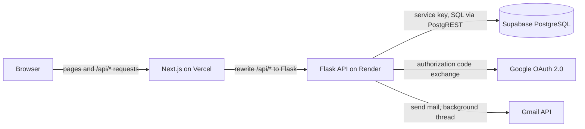
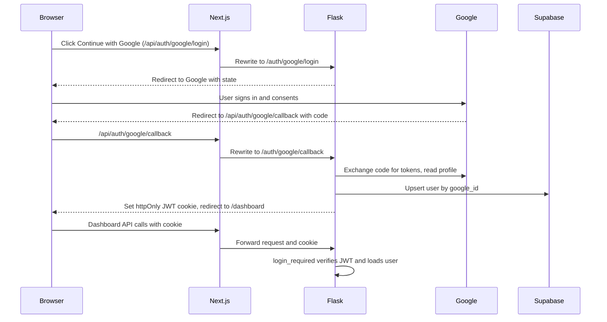

# Task Manager

A task management web app where users sign in with Google, create tasks, assign them to other users, and get Gmail notifications when a task is created or completed.

**Live app:** https://task-manager-ten-eta-92.vercel.app
**API health check:** https://task-manager-4wps.onrender.com/health

## Features

- Sign in with Google (OAuth 2.0). Accounts are created automatically on first login.
- Create tasks with a title, description, priority, due date, and an optional assignee chosen from registered users.
- Assign tasks to other users. Both the creator and the assignee can see the task.
- Email notifications through the Gmail API when a task is created and when it is completed. Both the creator and the assignee are notified.
- Task workflow: pending, in progress, completed.
- Dashboard views (all, assigned to me, created by me) and a status filter.
- Overdue indicator for tasks past their due date.
- Permissions: only the creator can edit details or delete a task; the creator or the assignee can start and complete it.
- Atomic completion, so a task can only be completed once and only one notification is sent even if two requests arrive at the same time.

## Tech stack

| Layer | Technology |
| --- | --- |
| Frontend | Next.js (App Router), TypeScript, Tailwind CSS |
| Backend | Flask, Authlib, PyJWT, Flask-CORS, Gunicorn |
| Database | Supabase (PostgreSQL) |
| Auth | Google OAuth 2.0 (Authorization Code flow) |
| Email | Gmail API (`gmail.send` scope, refresh token) |
| Hosting | Vercel (frontend), Render (backend), Supabase (database) |

## Architecture



### Request flow

The browser only talks to the Next.js origin. Next.js rewrites every `/api/*` request to the Flask service. This keeps the session cookie first-party to the frontend domain, which avoids cross-site cookie and CORS problems between Vercel and Render.

### Authentication flow



Key points:

- Flask owns the OAuth flow. Authlib stores a random `state` in a session cookie and verifies it on the callback to prevent CSRF.
- After login, Flask issues its own signed JWT (HS256, 7 days) containing the user id, stored in an `httpOnly` cookie so JavaScript cannot read it.
- The `login_required` decorator verifies the JWT, loads the user from the database, and exposes it as `g.user`.
- Users are matched on the stable Google `sub` (`google_id`), not on email.

### Notification flow

1. A task is created or completed through the API.
2. The route fetches the task with its creator and assignee, then calls the email service.
3. The email service builds HTML and plain-text bodies (all user content is HTML-escaped) and starts a daemon thread.
4. The thread exchanges the stored Gmail refresh token for a short-lived access token and calls `users.messages.send`.
5. Failures are logged and never affect the API response.

Completion is a single conditional SQL update (`WHERE id = ? AND status != 'completed'`). Only one concurrent request can win it, and only the winner triggers emails.

### Database

Migrations live in [`/migrations`](./migrations) as plain SQL. Run them in order in the Supabase SQL editor.

```
users
  id            uuid, primary key
  google_id     text, unique
  email         text, unique
  name          text
  avatar_url    text
  created_at    timestamptz

tasks
  id            uuid, primary key
  title         text, 1 to 200 characters
  description   text
  status        enum: pending, in_progress, completed
  priority      enum: low, medium, high
  due_date      date
  created_by    uuid, references users, on delete cascade
  assigned_to   uuid, references users, on delete set null
  created_at    timestamptz
  updated_at    timestamptz, maintained by a trigger
  completed_at  timestamptz
```

- Indexes exist on `assigned_to`, `created_by`, and `status`.
- Row Level Security is enabled on both tables with no policies. The public anon key cannot read or write anything. Only the backend, using the Supabase secret key, accesses the data.
- A trigger keeps `updated_at` current on every update.

## Project structure

```
Task-manager/
├── backend/
│   ├── app/
│   │   ├── __init__.py
│   │   ├── config.py
│   │   ├── db.py
│   │   ├── email_service.py
│   │   ├── extensions.py
│   │   ├── utils.py
│   │   └── routes/
│   │       ├── auth.py
│   │       ├── tasks.py
│   │       └── users.py
│   ├── scripts/
│   │   └── get_gmail_token.py
│   ├── requirements.txt
│   └── wsgi.py
├── frontend/
│   ├── app/
│   │   ├── page.tsx
│   │   └── dashboard/page.tsx
│   ├── components/
│   │   ├── TaskCard.tsx
│   │   └── TaskForm.tsx
│   ├── lib/
│   │   ├── api.ts
│   │   └── types.ts
│   └── next.config.ts
├── migrations/
│   └── 001_init_users_and_tasks.sql
├── .env.example
└── README.md
```

## API reference

All endpoints except the auth flow and health check require the login cookie.

| Method | Path | Description |
| --- | --- | --- |
| GET | `/health` | Health check |
| GET | `/auth/google/login` | Start the Google OAuth flow |
| GET | `/auth/google/callback` | OAuth callback, sets the session cookie |
| GET | `/auth/me` | Current user |
| POST | `/auth/logout` | Clear the session cookie |
| GET | `/users` | List users (for the assignee picker) |
| GET | `/tasks?view=all\|assigned\|created&status=...` | List tasks visible to the current user |
| POST | `/tasks` | Create a task and send notifications |
| GET | `/tasks/<id>` | Get one task |
| PATCH | `/tasks/<id>` | Update details (creator only) or status (`pending`, `in_progress`) |
| POST | `/tasks/<id>/complete` | Complete a task and send notifications |
| DELETE | `/tasks/<id>` | Delete a task (creator only) |

Errors are returned as `{"error": "message"}` with an appropriate status code: 400 validation, 401 unauthenticated, 403 forbidden, 404 not found, 409 already completed.

## Environment variables

Copy `.env.example` and fill in the values.

| Variable | Where | Purpose |
| --- | --- | --- |
| `SUPABASE_URL` | backend | Supabase project URL |
| `SUPABASE_SERVICE_ROLE_KEY` | backend | Supabase secret key (server only, never expose) |
| `GOOGLE_CLIENT_ID` | backend | Google OAuth client id |
| `GOOGLE_CLIENT_SECRET` | backend | Google OAuth client secret |
| `JWT_SECRET` | backend | Signing key for session tokens |
| `FRONTEND_URL` | backend | Public frontend URL, used for CORS and OAuth redirects |
| `BACKEND_URL` | backend | Public backend URL |
| `COOKIE_SECURE` | backend | `true` in production (HTTPS only cookies) |
| `COOKIE_SAMESITE` | backend | `Lax` |
| `GMAIL_SENDER_EMAIL` | backend | Gmail account that sends notifications |
| `GMAIL_REFRESH_TOKEN` | backend | Refresh token for the sender account |
| `API_URL` | frontend | Flask base URL used by the Next.js rewrite |

## Local setup

### 1. Database

1. Create a Supabase project.
2. Open the SQL editor and run `migrations/001_init_users_and_tasks.sql`.
3. Copy the project URL and the secret key from Project Settings, API Keys.

### 2. Google Cloud

1. Create a project and configure the OAuth consent screen (External). Add your Gmail accounts as test users.
2. Enable the Gmail API and add the `https://www.googleapis.com/auth/gmail.send` scope.
3. Create an OAuth client of type Web application.
   - Authorized JavaScript origin: `http://localhost:3000`
   - Authorized redirect URIs:
     - `http://localhost:3000/api/auth/google/callback`
     - `http://localhost:8080/`
4. Copy the client id and secret.

### 3. Backend

```bash
cd backend
python3 -m venv venv
source venv/bin/activate
pip install -r requirements.txt
cp ../.env.example .env
```

Fill in `backend/.env`, then generate a Gmail refresh token for the sender account:

```bash
pip install google-auth-oauthlib
python3 scripts/get_gmail_token.py
```

Put the printed token in `GMAIL_REFRESH_TOKEN`, then start the API:

```bash
flask --app wsgi run --debug --port 5001
```

### 4. Frontend

```bash
cd frontend
npm install
echo "API_URL=http://localhost:5001" > .env.local
npm run dev
```

Open http://localhost:3000.

## Deployment

| Service | Platform | Configuration |
| --- | --- | --- |
| Database | Supabase | Run the migrations |
| Backend | Render (Web Service) | Root directory `backend`, build `pip install -r requirements.txt`, start `gunicorn wsgi:app` |
| Frontend | Vercel | Root directory `frontend`, env `API_URL` set to the Render URL |

Production notes:

- Set `FRONTEND_URL` on Render to the Vercel URL and `COOKIE_SECURE=true`.
- Add `https://YOUR-APP.vercel.app/api/auth/google/callback` to the Google OAuth client redirect URIs and the Vercel origin to the authorized JavaScript origins.
- Publish the OAuth consent screen to production so the Gmail refresh token does not expire after 7 days (apps in Testing mode have short-lived refresh tokens).

## Design decisions

- **Own session instead of provider tokens.** Flask runs the OAuth flow and issues its own JWT in an `httpOnly` cookie, so the frontend never handles tokens.
- **Rewrite proxy.** Routing `/api/*` through Next.js keeps cookies first-party and removes cross-origin complexity in production.
- **Atomic state change for completion.** One conditional update decides the winner, which makes the 409 response and the single email deterministic under concurrency.
- **Background email sending.** A slow or failing Gmail call can never fail or delay a task request.
- **One Supabase client per thread.** The HTTP/2 client is not safe to share across concurrent request threads.
- **Deny-by-default database.** RLS is on with no policies, and the secret key lives only on the server.

## Possible improvements

- Comments on tasks and an activity log
- Reminder emails for tasks approaching or past their due date
- Search across tasks
- Retry queue for failed emails
- Automated tests for the API